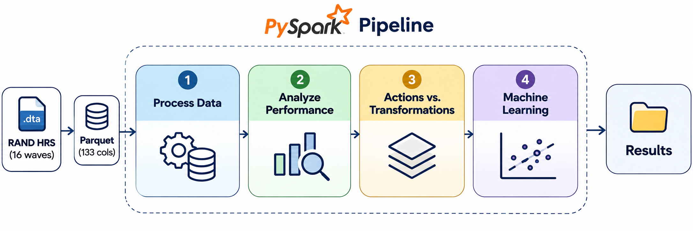
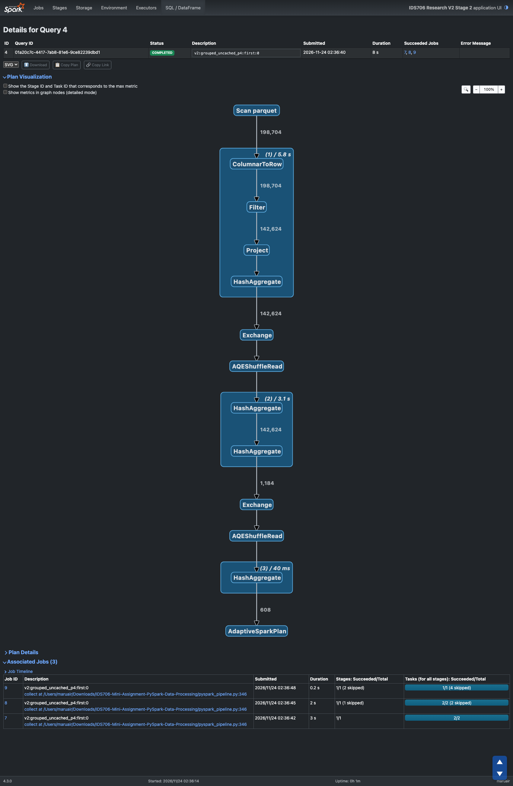
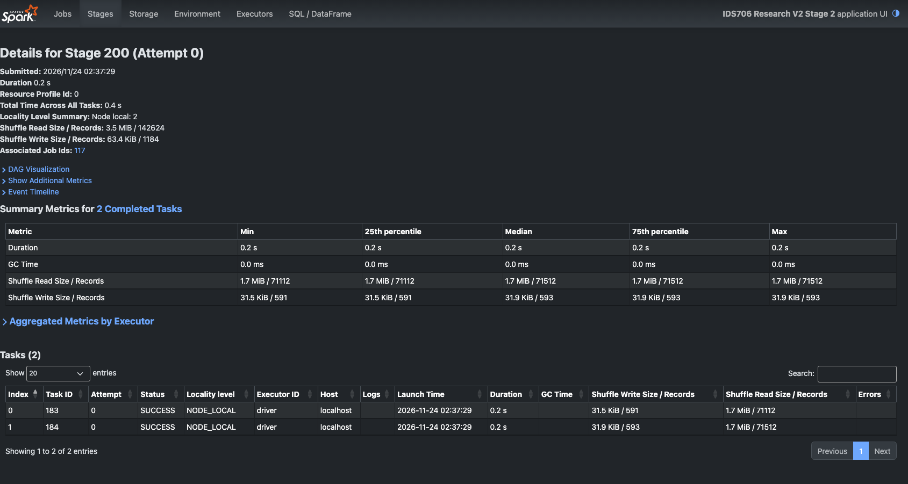
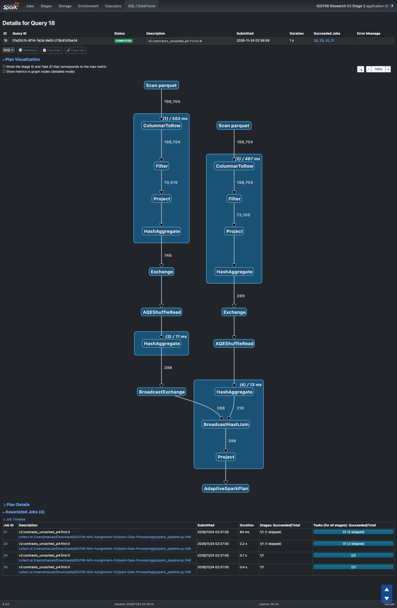

# IDS 706 Mini Assignment: PySpark Data Processing - 24 Nov 2026


## Project Description
- This project aims to build a PySpark data processing pipeline that demonstrates understanding of distributed data processing, lazy evaluation, and optimization strategies.
- The analysis for this project focused on examining the relationship between sleep quality and cognitive performance across age and education groups using PySpark SQL and MLlib regression.

## Project Structure
```text
IDS706-Mini-Assignment-PySpark-Data-Processing/
├── pyspark_pipeline.py     # All stages of PySpark processing
├── requirements.txt        # Python dependencies
├── README.md               # Project overview, setup, and key findings
├── .gitignore              # Excludes datasets, generated outputs, and local files
├── images/                 # Pipeline diagram and screenshots supporting the README
└── output/                 # Generated results and execution evidence
```
<br><br>

## Overall Setup Instructions
### 1. Create GitHub repository
General:
- Name the repository with `IDS706-Mini-Assignment-PySpark-Data-Processing`.

Configuration:
- Add README - Toggle On option.
- Add .gitignore - Select Python.
- Proceed to create repository.

### 2. Clone repository in VS Code
- Open Command Palette and select `Git: Clone`.
- Paste GitHub repository URL (e.g. https://github.com/violathadtanone/IDS706-Mini-Assignment-PySpark-Data-Processing).
- Select the local folder to continue the development.

### 3. Set up a Python virtual environment
- Create and activate the virtual environment on Terminal with the code below:
```bash
python -m venv .venv
source .venv/bin/activate
```
- Upgrade pip to ensure that it is compatible with the current Python version before installing other packages.
```bash
python -m pip install --upgrade pip
```


### 4. Create requirement file for project dependencies (e.g. python packages required)
- Create a new file called `requirements.txt` in the project root and add packages below in the file.
```
pandas
pyreadstat
pyarrow
pyspark
```

- Install the requirements with the code below in Terminal:
```bash
python -m pip install -r requirements.txt
```
<br><br>

## Dataset Description and Source
- For this analysis, the dataset is from [RAND HRS Longitudinal File 2022 (Version 2)](https://hrsdata.isr.umich.edu/data-products/rand-hrs-longitudinal-file-2022). This is based on the University of Michigan's Health and Retirement Study, which follows older Americans' health, cognition, finances, and other characteristics. 
- The raw dataset is **1.85 GB** in size. It includes 45,165 respondents across 16 survey waves (1992–2022), allowing researchers to examine changes in health and well-being over time.
- The analysis uses cognitive recall scores, four sleep-quality indicators, age, education level, and survey wave to examine the relationship between sleep quality and cognitive performance.
<br><br>

## Pipeline Overview

#### Stage 1 — Data Processing Pipeline
- Data ingestion: Convert the 1.85GB Stata dataset into Parquet using chunked processing and 134 selected columns.
- Transformations: Apply `filter()` and `withColumn()` to clean data and categorize sleep quality using a researcher-defined disturbance score (0–8): high (0–2), medium (3–5), and low (6–8).
- Analysis: Use groupBy().agg() and two Spark SQL queries to compare cognitive scores across sleep-quality levels, age groups, and education.
- Optimization and output: Apply early filtering, column selection, and AQE; save 142,624 eligible observations to Parquet.

#### Stage 2 — Performance Analysis
- Execution plans: Use .explain() and Spark UI to examine query execution and optimization.
- Benchmarking: Compare query performance across partition settings and cached versus uncached execution.
- Output: Save execution plans, performance metrics, and Spark UI screenshots.

#### Stage 3 — Actions vs. Transformations
- This stage demonstrates **Spark's lazy evaluation**: transformations define operations, while actions trigger their execution.

| Transformations (Lazy) | Actions (Eager) |
|---|---|
| `select()` — Select columns | `count()` — Count observations |
| `filter()` — Filter rows | `show()` — Display results |
| `withColumn()` — Create a new column | |
| `groupBy().agg()` — Define aggregations | |
| **0 Spark jobs triggered** | **Spark jobs triggered** |

- Illustrative example:
```python
# Lazy transformations: no Spark jobs executed
filtered = df.filter(df.age >= 50)
summary = filtered.groupBy("sleep_quality").count()

# Action: Spark executes the transformations
summary.show()
```

- Verification: Spark job tracking confirmed zero jobs during transformations, while `count()` triggered jobs 1–2 and `show()` triggered jobs 3–4. This demonstrates that Spark delays computation until an action requests the results.

#### Stage 4 — Machine Learning
- Modeling: Train MLlib linear regression models using sleep quality, age, education, and survey wave.
- Interaction analysis: Include sleep-quality × age interactions to examine whether associations vary with age.
- Evaluation: Use an 80/20 respondent-level train/test split and compare RMSE, MAE, and R² against a baseline.
- Output: Save trained models, predictions, coefficients, and evaluation results.
- Run the stages below sequentially **from the project root**. Use Java 17 and the project virtual environment. Stage 2 screenshot capture requires installed macOS Google Chrome at `/Applications/Google Chrome.app/Contents/MacOS/Google Chrome`.
- These output directories already exist locally. Add `--overwrite` to each command only when intentionally regenerating that revised stage; the commands below are for a first run.
```bash
.venv/bin/python -B pyspark_pipeline.py --stage 1 --output-dir output/stage1
.venv/bin/python -B pyspark_pipeline.py --stage 2 --stage1-dir output/stage1 --output-dir output/stage2
.venv/bin/python -B pyspark_pipeline.py --stage 3 --stage1-dir output/stage1 --output-dir output/stage3
.venv/bin/python -B pyspark_pipeline.py --stage 4 --stage1-dir output/stage1 --output-dir output/stage4
```
<br><br>

## Performance Analysis Results

**Q1: How did Spark optimize the queries? Where were filters pushed down?**
- Spark optimized query execution through predicate pushdown, column pruning, and Adaptive Query Execution (AQE). 
- The physical execution plans generated using .explain() show that the grouped-summary query reads only 10 of 19 columns, while the comparison query reads eight per branc.
- Filters for proxy status, education, valid cognitive recall, imputation flags, and sleep-quality availability were pushed toward the Parquet scan, reducing unnecessary data processing. 
- The self-join also pushed sleep-quality restrictions into the relevant branches. These optimizations reduced the amount of data processed before aggregation, although actual Parquet row-group skipping was not independently verified.



**Q2: What performance bottlenecks were identified? How was the pipeline optimized?**
- Spark UI Query Details revealed that aggregations required Exchange shuffle operations, while the comparison query used a BroadcastHashJoin to efficiently join aggregated results. AQE further optimized execution by coalescing shuffle partitions. 
- The largest shuffle write was approximately 3.65 MB, with no memory or disk spill. Although shuffle operations introduced data movement, the available metrics did not identify a dominant performance bottleneck. 
- The pipeline minimized unnecessary processing through early filtering, column pruning, and fewer shuffle partitions. 
- In local benchmarks, two shuffle partitions performed better than four, with median times of 1.112 vs. 1.633 seconds for grouped summaries and 0.584 vs. 0.776 seconds for comparisons.





**Q3: Did caching improve performance for repeated actions?**
- Using .cache(), median execution time decreased from 1.633 to 1.034 seconds for grouped summaries and from 0.776 to 0.481 seconds for comparison queries. 
- Although populating the cache required 2.285 seconds, total execution time across five repetitions of both workloads decreased from 11.296 seconds (uncached) to 9.918 seconds (cached, including population), an improvement of approximately 12%. 
- This demonstrates that caching can improve repeated query performance when its initialization cost is outweighed by subsequent savings. 
- Results reflect local execution and exclude the initial Stata-to-Parquet conversion.
<br><br>

## Key Findings from Data Analysis
### 1. Sleep Quality and Cognitive Performance

Respondents with **high sleep quality had the highest average cognitive recall scores**. The analysis included 142,624 observations across three sleep-quality categories.

| Sleep Quality | Observations | Mean Recall (0–20) |
|---|---:|---:|
| High | 72,105 | 10.074 |
| Medium | 53,685 | 9.631 |
| Low | 16,834 | 9.462 |

- Respondents with medium sleep quality scored **0.443 points lower** than those with high sleep quality.
- Respondents with low sleep quality scored **0.612 points lower** than those with high sleep quality.

### 2. Adjusted Regression Results

After accounting for **age, education, and survey wave**, the additive regression model showed:

- **Medium sleep quality:** 0.160 points lower than high sleep quality.
- **Low sleep quality:** 0.370 points lower than high sleep quality.

The results suggest an association between poorer sleep quality and lower cognitive performance, even after adjusting for these variables.

### 3. Does the Relationship Change with Age?

The interaction model suggests that **differences in cognitive recall across sleep-quality groups become smaller at older ages**.

| Age | High Sleep | Medium Sleep | Low Sleep |
|---|---:|---:|---:|
| 55 | 10.982 | 10.672 | 10.318 |
| 65 | 9.928 | 9.739 | 9.528 |
| 75 | 8.874 | 8.806 | 8.738 |
| 85 | 7.820 | 7.872 | 7.948 |

*Predicted scores assume a high-school education and survey wave 12 (2014).*

These are model-estimated patterns, not evidence that poor sleep improves cognition at older ages. Statistical significance of the interaction was not tested.

### 4. Machine Learning Model Performance

Both regression models performed better than the baseline on held-out respondents.

| Model | RMSE | MAE | R² |
|---|---:|---:|---:|
| Baseline | 3.4495 | 2.7428 | -0.00002 |
| Additive Regression | 3.1064 | 2.4584 | 0.18901 |
| Interaction Regression | 3.1049 | 2.4577 | 0.18982 |

- The **interaction model achieved the lowest prediction error**, although its improvement over the additive model was very small.
- Both adjusted models explained approximately **19% of the variation** in cognitive recall scores on the test set.

### 5. Limitations
The analysis is observational and uses researcher-defined sleep-quality categories. Missing data, repeated observations from the same respondents, and unmeasured factors may influence the results. Therefore, **the findings indicate associations, not causal relationships**, and should not be interpreted as statistically significant effects without further testing.
